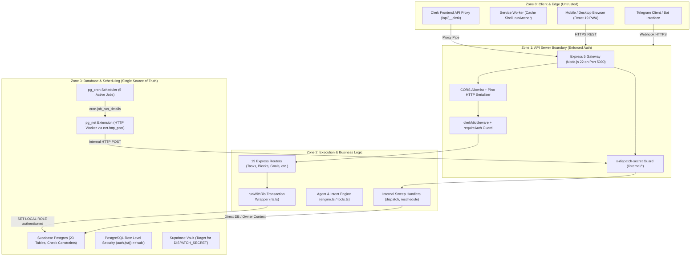
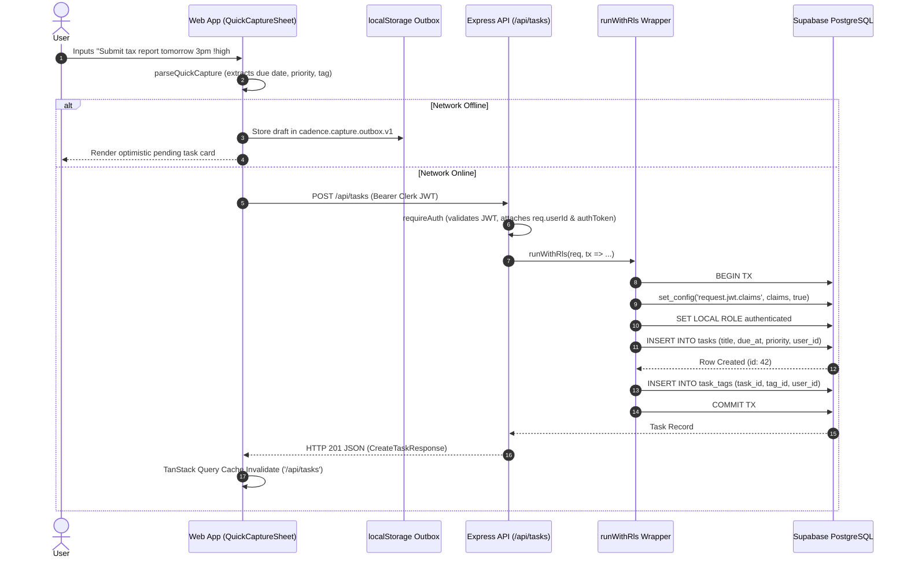
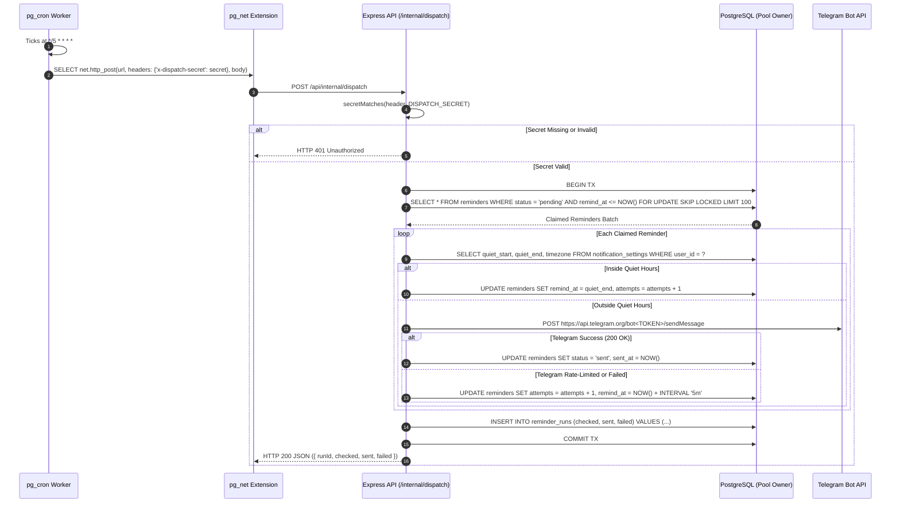
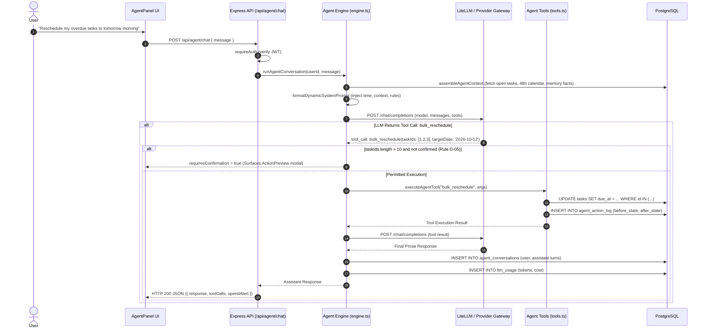

# 02 — Architecture, Trust Boundaries & Data Flows

> **Zero-Trust Architectural Investigation**  
> **Workspace Root:** `c:\PROJECTS\PIOS\ClonU\Driftloom\Cadence-Task-OS`  
> **Audited Date:** 2026-10-11  
> **Auditor Posture:** Principal Security Architect & SRE Lead  

---

## 1. System Topology & Trust Boundaries

Cadence is a multi-tenant personal task and time operating system structured into four primary trust zones:



---

## 2. Core Security & Isolation Mechanics

### 2.1 The RLS Bridge Architecture (`artifacts/api-server/src/lib/rls.ts`)
The API server connects to PostgreSQL using `DATABASE_URL` as the database owner (`postgres`). By default in PostgreSQL, table owners bypass RLS entirely. Pointing queries at Supabase without transaction-level role demotion provides zero multi-tenant security.

Cadence enforces multi-tenancy through `runWithRls(req, fn)`:
```typescript
function claimsJsonFromJwt(token: string): string {
  const parts = token.split(".");
  if (parts.length !== 3 || !parts[1]) {
    throw new Error("Malformed session token");
  }
  const base64 = parts[1].replace(/-/g, "+").replace(/_/g, "/");
  const padded = base64 + "=".repeat((4 - (base64.length % 4)) % 4);
  return Buffer.from(padded, "base64").toString("utf8");
}

const NO_USER_CLAIMS = JSON.stringify({ sub: null, role: "authenticated" });

export async function runWithRls<T>(
  req: Request,
  fn: (tx: DbTransaction) => Promise<T>,
): Promise<T> {
  const claims = req.authToken ? claimsJsonFromJwt(req.authToken) : NO_USER_CLAIMS;
  return db.transaction(async (tx) => {
    await tx.execute(
      sql`SELECT set_config('request.jwt.claims', ${claims}, true)`,
    );
    await tx.execute(sql`SET LOCAL ROLE authenticated`);
    return fn(tx);
  });
}
```

#### Isolation Invariants & Guarantees
1. **Transaction Isolation:** `set_config('request.jwt.claims', claims, true)` marks the configuration parameter as transaction-local (`is_local = true`). Upon transaction commit or rollback, the setting is purged, preventing leakage across connection pool re-use.
2. **Role Demotion:** `SET LOCAL ROLE authenticated` drops the owner connection privileges to the Supabase `authenticated` role for the duration of the transaction.
3. **Fail-Closed Fallback:** If `req.authToken` is undefined or fails retrieval in `requireAuth`, `claims` defaults to `NO_USER_CLAIMS` with `sub: null`. In PostgreSQL ternary logic, `NULL = user_id` evaluates to `NULL` (falsy), rejecting all `SELECT`, `UPDATE`, `INSERT`, and `DELETE` queries.
4. **Defense-in-Depth:** Every Drizzle query inside route handlers includes an application-level filter: `.where(and(eq(tasksTable.userId, req.userId!), ...))`.

---

## 3. End-to-End Workflow Sequences

### 3.1 Task Capture & Natural Language Ingestion Sequence



---

### 3.2 Scheduled Sweeps & Dispatch Engine Sequence (`pg_cron` + `pg_net`)



---

### 3.3 AI Agent Conversation & ReAct Tool Loop Sequence



---

## 4. Architectural Inconsistencies & Trust Boundary Traps

### 4.1 Routing Inconsistency in `app.ts` (`/api/healthz`)
- **Observed:** Line 48 of `artifacts/api-server/src/app.ts` executes:
  `app.use("/api/healthz", healthRouter);`
- **Implementation:** Inside `routes/health.ts`, the router defines `router.get("/healthz", ...)`.
- **Result:** Mounting `healthRouter` at `/api/healthz` registers the route as `/api/healthz/healthz`.
- **Why it currently passes tests:** `healthRouter` is also imported in `routes/index.ts` and mounted at `app.use("/api", router)`. When a client requests `GET /api/healthz`, it is handled by the second mount inside `router`.
- **Architectural Consequence:** The route is handled **after** `clerkMiddleware` (lines 53–63), defeating the architectural intent (comment lines 39–47) to answer liveness probes *before* Clerk key validation.

### 4.2 Global Kill Switch Endpoint Authentication & Scope
- **Location:** `artifacts/api-server/src/routes/automation.ts` (`PUT /api/automation/flags/:key`).
- **Issue:** The route requires `requireAuth` but does not verify whether the authenticated user is a system administrator or owner. Furthermore, `automation_flags` is a single global database table without a `user_id` column.
- **Vulnerability:** Any authenticated user can disable reminders or reschedule sweeps globally for all users in the system.

### 4.3 Direct DB Invocations Bypassing RLS
Multiple backend services query the database connection pool directly without `runWithRls`:
1. **Telegram Webhook (`routes/telegram.ts`):** Inbound webhooks lack Clerk JWTs and use direct `db` queries, relying entirely on application-level filtering (`where(eq(tasksTable.userId, userId))`).
2. **Internal Cron Endpoints (`routes/internal.ts`):** Sweeps execute directly under table-owner privileges guarded solely by `x-dispatch-secret`.
3. **Agent Tool Executor (`lib/agent/tools.ts`):** Tool mutations execute via direct `db` queries with application-level `where` filters instead of the RLS transaction context.

---
*Verified through source analysis of `artifacts/api-server/src/app.ts`, `rls.ts`, `engine.ts`, `internal.ts`, and `spec/agent-and-memory-subsystem.md`.*
