# 05 — Test Strategy, Environments & Seed Data Architecture

> **Zero-Trust Test Strategy Blueprint**  
> **Workspace Root:** `c:\PROJECTS\PIOS\ClonU\Driftloom\Cadence-Task-OS`  
> **Audited Date:** 2026-10-11  
> **Auditor Posture:** Principal QA Architect & SRE Lead  

---

## 1. Test Environment Topology

Testing must be strictly partitioned across four execution tiers:

```mermaid
flowchart LR
    subgraph L1 ["Tier 1: Local Offline (Fast)"]
        Unit["Vitest Unit Suites (856 Tests)"]
        Type["TypeScript Compiler (Gate 1)"]
        Tokens["Design Token Lint (Gate 2)"]
    end

    subgraph L2 ["Tier 2: Local Container / Preview"]
        DBLocal["Ephemeral Postgres Container (:54322)"]
        Preview["Vite Preview Server (:4173)"]
        PlaywrightMock["Playwright E2E Self-Mocked (144 Tests)"]
    end

    subgraph L3 ["Tier 3: CI Pipeline (GitHub Actions)"]
        Ladder["12-Gate Ladder (Ubuntu, Node 22, pnpm)"]
        PWCI["CI Playwright Job with Headless Chromium"]
        Porcelain["git status --porcelain (Zero Drift Check)"]
    end

    subgraph L4 ["Tier 4: Live Staging / Production (Zero-Trust)"]
        Render["Render API Server (Port 5000)"]
        Supabase["Live Supabase Postgres (23 Tables)"]
        ClerkLive["Live Clerk Auth Instance"]
        G4Harness["G4 Manual Runbook & Physical Devices"]
    end

    L1 --> L2 --> L3 --> L4
```



---

## 2. Automated vs. Manual Testing Distribution

Under Zero-Trust, we distinguish what can be continuously proven in software from what fundamentally demands human or physical device verification:

| Testing Domain | Automated Coverage Method | Why It Can Be Automated | Manual Execution Method | Why It MUST Remain Manual |
|---|---|---|---|---|
| **API Contract & Schema** | Vitest + Zod schema validation | Deterministic JSON shapes and HTTP status codes. | N/A | Fully automated via Gate 5 & Gate 12. |
| **Cross-Tenant RLS** | Two-account isolation scripts (`verify:isolation`) | Synthetic users can query each other's IDs via automated API calls. | Spot-check via SQL Editor | Edge-case verification during migrations. |
| **Sizing & Token CSS** | Headless Playwright sizing probe (`verify:sizing`) | Layout engine measures bounding box dimensions of custom utilities. | Visual regression inspection | Subjective aesthetics, liquid glass restraint. |
| **Color Contrast & Theme**| Axe-core Playwright + `verify:contrast` script | Mathematical contrast calculation of hex/hsl pairs. | Manual high-glare OLED check | Actual readability under bright sunlight. |
| **Focus Timer Persistence**| Unit test wall-clock delta derivation (`runAnchor.test.ts`) | Algorithm is pure arithmetic on `Date.now()`. | **G4-d Physical Device Test** | **OS background task suspension:** Mobile Safari/Chrome aggressively freezes JS tabs. Wall-clock recovery must be physically observed after a 5-minute phone lock. |
| **Multi-Tab Audio Master** | Vitest with Web Locks API mock | Web Locks API mock asserts lock acquisition logic. | Dual-tab browser test | Real audio hardware output verification. |
| **Telegram Bot Webhook** | Automated HTTP simulation (`http-contract.test.ts`) | Asserts `TELEGRAM_WEBHOOK_SECRET` 401 boundary. | **G4-e Real Telegram Interaction**| Physical Telegram app delivery latency, button rendering, push notifications. |
| **Screen-Reader Ergonomics**| Axe-core automated ARIA checks | Validates presence of `aria-` attributes and roles. | NVDA / VoiceOver manual pass | Pronunciation, tab order cadence, cognitive confusion. |

---

## 3. The Synthetic Data Seeding Imperative (Unblocking G4 Backlog)

### 3.1 The Production Data Blocker Reality
Live database inspection on 2026-10-11 revealed:
```text
tasks:                0 rows
reminders:            0 rows
monthly_goals:        0 rows
memory_facts:         0 rows
agent_action_log:     0 rows
notification_settings: 2 rows
```
**Consequence:** Checks **G4-e through G4-k are blocked on EMPTY DATA, not software defects.**
- The reminder dispatcher reports `checked: 0` because no reminders are due.
- The reschedule engine reports `swept: 0` because no tasks are overdue.
- The memory extraction job cannot compute Rule 9 duration multipliers because 0 completed tasks exist.

### 3.2 Safe Synthetic Seeding Script (`scripts/seed-g4-synthetic.ts`)
To unblock verification without contaminating production metrics or altering real user data, seed synthetic rows under a dedicated test user identity:

```typescript
/**
 * Synthetic Seed Fixture for G4 Verification Ladder
 * Creates controlled past-due tasks, pending reminders, and completed focus sessions.
 */
export async function seedG4SyntheticData(tx: DbTransaction, testUserId: string) {
  const now = new Date();
  const yesterday = new Date(now.getTime() - 24 * 3600 * 1000);
  const twoHoursAgo = new Date(now.getTime() - 2 * 3600 * 1000);
  const tomorrow = new Date(now.getTime() + 24 * 3600 * 1000);

  // 1. Overdue task for G4-f (Reschedule Sweep verification)
  const [overdueTask] = await tx.insert(tasksTable).values({
    userId: testUserId,
    title: "SYNTHETIC: Overdue quarterly tax review",
    status: "open",
    priority: "high",
    dueAt: yesterday,
    durationMinutes: 45,
    automationMode: "auto",
    rescheduleCount: 0,
  }).returning();

  // 2. Due reminder for G4-e (Telegram Reminder verification)
  await tx.insert(remindersTable).values({
    userId: testUserId,
    taskId: overdueTask.id,
    remindAt: twoHoursAgo, // Due immediately
    status: "pending",
    channel: "telegram",
    attempts: 0,
  });

  // 3. Completed tasks + focus sessions for G4-i (Rule 9 Multiplier calculation)
  const [completedTask] = await tx.insert(tasksTable).values({
    userId: testUserId,
    title: "SYNTHETIC: Completed architecture spec",
    status: "completed",
    priority: "medium",
    durationMinutes: 30, // Estimated: 30 min
    completedAt: yesterday,
  }).returning();

  await tx.insert(focusSessionsTable).values({
    userId: testUserId,
    taskId: completedTask.id,
    durationSeconds: 3600, // Actual: 60 min (Ratio = 2.0x)
    completed: true,
  });

  // 4. Monthly goal for G4-k (Goal snapshot verification)
  const currentMonthStr = `${now.getFullYear()}-${String(now.getMonth() + 1).padStart(2, "0")}`;
  await tx.insert(monthlyGoalsTable).values({
    userId: testUserId,
    month: currentMonthStr,
    title: "SYNTHETIC: Complete 10 deep focus hours",
    targetMetric: "focus_minutes",
    targetValue: 600,
    status: "active",
  });
}
```

---

## 4. Disposable Fixture & Cleanup Protocol

1. **Synthetic Isolation:** All synthetic fixtures MUST use titles prefixed with `SYNTHETIC:` and be tagged with a distinct `#verification-test` tag.
2. **Instant Cleanup Procedure:** After manual verification execution, run the cleanup query:
   ```sql
   DELETE FROM public.tasks WHERE title LIKE 'SYNTHETIC:%';
   DELETE FROM public.monthly_goals WHERE title LIKE 'SYNTHETIC:%';
   DELETE FROM public.memory_facts WHERE key LIKE 'synthetic_%';
   ```
3. **Foreign Key Cascade Safety:** Because `time_blocks`, `reminders`, and `task_files` cascade `ON DELETE CASCADE` from `tasks`, deleting the synthetic parent tasks cleanly purges all child records. Focus sessions linked to synthetic tasks must be deleted before tasks due to `ON DELETE NO ACTION`.

---
*Strategy approved for manual execution under zero-trust safety constraints.*
