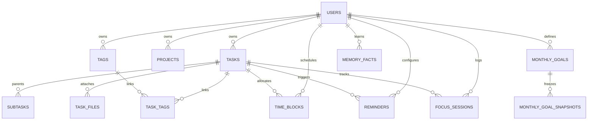

# Specialized Subsystem Report: Data Integrity, Migrations & Schema Architecture

> **Zero-Trust Data Integrity Audit**  
> **Workspace Root:** `c:\PROJECTS\PIOS\ClonU\Driftloom\Cadence-Task-OS`  
> **Audited Date:** 2026-10-11  
> **Auditor Posture:** Principal Data Architect & Database Administrator  

---

## 1. Schema Topology & Table Classifications

Cadence manages **23 tables** organized into three distinct tiers:

### Decoupled User Identity
There is **no foreign key constraint on `user_id`** to PostgreSQL's `auth.users`. User identity is an unconstrained `TEXT NOT NULL` column populated by Clerk JWT claims (`auth.jwt()->>'sub'`).

---

## 2. Foreign Key & Cascade Delete Dynamics

| Relation | Source Column | Target Column | On Delete Action | Business Invariant Enforced |
|---|---|---|---|---|
| Task Project | `tasks.project_id` | `projects.id` | **SET NULL** | Tasks survive unfiled; project deletion never wipes user tasks. |
| Subtask Parent | `tasks.parentId` | `tasks.id` | **RESTRICT** | Deleting a parent task with active subtasks fails loudly; prevents accidental hierarchy loss. |
| Focus History | `focus_sessions.task_id` | `tasks.id` | **NO ACTION (RESTRICT)** | Deleting a task with completed focus history fails loudly to preserve historical work metrics. Tasks must be archived instead. |
| Tag Links | `task_tags.task_id, tag_id` | `tasks.id, tags.id` | **CASCADE** | Junction rows clean up automatically. |
| Calendar Blocks | `time_blocks.task_id` | `tasks.id` | **CASCADE** | Calendar plans clear when task is deleted. |
| Reminders | `reminders.task_id` | `tasks.id` | **CASCADE** | Pending alerts cancelled when task is removed. |
| Goal Snapshot | `monthly_goal_snapshots.goal_id` | `monthly_goals.id` | **SET NULL** | Snapshots are permanent historical records. |

---

## 3. Database Check Constraints & Enums

- **Task Status:** `CHECK (status IN ('inbox', 'open', 'completed', 'archived'))`
- **Task Priority:** `CHECK (priority IN ('low', 'medium', 'high'))`
- **Immediate Self-Parenting Block:** `CHECK (parent_id IS NULL OR parent_id != id)`
- **Completion Timestamp Integrity:**
  `CHECK ((status = 'completed' AND completed_at IS NOT NULL) OR (status = 'archived' AND (completed_at IS NOT NULL OR completed_at IS NULL)) OR (status IN ('inbox', 'open') AND completed_at IS NULL))`
- **Time Block Boundaries:** `CHECK (end_at > start_at)`
- **Monthly Goal Scope:** Enforces mutual exclusivity between `global`, `project`, and `tag` scopes.
- **Snapshot Immutability Triggers:** `trg_prevent_goal_snapshot_update` and `trg_prevent_goal_snapshot_delete` raise SQL exceptions on any attempt to update or delete rows in `monthly_goal_snapshots`.

---

## 4. Indexing Strategy & Search Optimization

1. **Full-Text Search (`tsvector`):**
   - Functional GIN index on `tasks`: `to_tsvector('english', coalesce(title, '') || ' ' || coalesce(notes, ''))`.
   - Powers fast full-text search across titles and notes using `ts_rank`.
2. **Partial Indexes:**
   - `tasks_user_archived_idx`: `(user_id, status) WHERE status = 'archived'`.
   - `tasks_rrule_idx`: `(rrule) WHERE rrule IS NOT NULL`.
   - `memory_facts_user_active_idx`: `(user_id, confidence DESC) WHERE archived = false`.
   - `agent_action_log_user_undone_idx`: `(user_id, created_at DESC) WHERE undone = false`.
3. **JSONB Path Operations:**
   - `memory_facts_value_gin_idx`: `USING gin (value jsonb_path_ops)`.
   - `memory_embeddings_metadata_gin_idx`: `USING gin (metadata jsonb_path_ops)`.

---

## 5. Migration Pipeline & Checksum Drift Protection (`lib/db/src/migrate.ts`)

- **Advisory Lock:** Acquires `SELECT pg_advisory_lock(8675309)` to guarantee single-runner execution across distributed instances.
- **Transactional Atomicity:** Each migration runs inside its own `BEGIN ... COMMIT` block. On failure, it executes `ROLLBACK` and leaves the database at the last good version.
- **SHA-256 Checksum Verification:** Computes the SHA-256 hash of each file on disk and verifies it against `cadence_schema_migrations.checksum`. If an already-applied file was modified, execution halts immediately with a fatal error.
- **Strict Out-of-Order Rejection:** Prevents inserting earlier migration versions before already-applied versions.
- **No Down Migrations:** Schema evolution is strictly forward-only; emergency rollbacks must be authored as forward migrations.

---
*Report certified by Principal Database Architect.*
