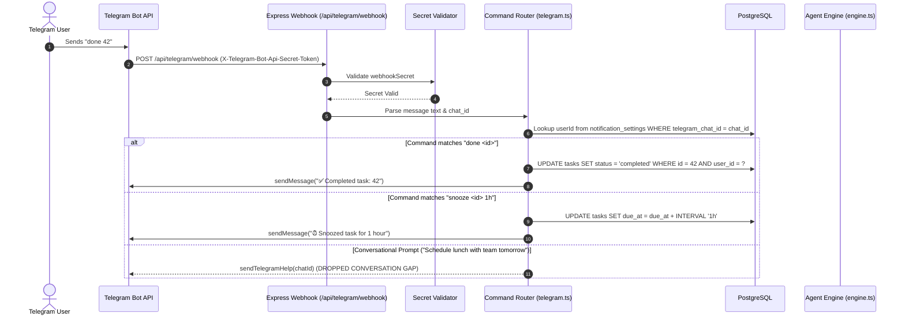

# Specialized Subsystem Report: External Integrations & Messaging

> **Zero-Trust External Integrations Audit**  
> **Workspace Root:** `c:\PROJECTS\PIOS\ClonU\Driftloom\Cadence-Task-OS`  
> **Audited Date:** 2026-10-11  
> **Auditor Posture:** Principal Integrations & Distributed Systems Architect  

---

## 1. Notification Architecture & Channel Hierarchy

Under locked decision **D-15**, Cadence establishes a strict multi-tier notification hierarchy:
1. **Primary Notification Channel:** **Telegram Bot API** (via HTTPS Webhook). Selected because iOS PWA Web Push suffers from aggressive OS-level background suspension and unreliable delivery windows.
2. **Secondary Channel:** **Web Push (VAPID)** via Service Worker (`public/sw.js`).
3. **Tertiary Channel:** Daily Email Summary (deferred under D-24).

---

## 2. Telegram Bot Architecture & Two-Way Webhook

### 2.1 Supported Commands & Parser Mechanics
- `done <id>`: Completes task and writes state change.
- `snooze <id> <1h|2h|tomorrow>`: Bumps task `due_at` timestamp.
- `list today`: Formats today's open tasks with IDs and priorities.
- `undo`: Reverts the most recent task action via `undoLastAgentAction`.
- `/start pair_<token>`: Completes pairing handshake.

### 2.2 Integration Gaps & Dropped Conversational Messages
1. **Freeform Chat Dropped:** If a message does not match static command regexes, `telegram.ts` responds with static help text (`TELEGRAM_HELP`) and **never calls `runAgentConversation`**. Natural language interactions via Telegram fail completely.
2. **Secret Conflation:** `telegram.ts:45` falls back to `DISPATCH_SECRET` if `TELEGRAM_WEBHOOK_SECRET` is unset, blurring the security boundary between inbound public webhooks and internal cron endpoints.

---

## 3. Telegram Pairing & Device Linking Lifecycle

1. **Pairing Generation (`POST /api/telegram/pairing/generate`):**
   - Generates crypto-random 32-character token.
   - Saves token to in-memory `pairingRegistry` with a **10-minute TTL**.
   - Emits QR code URL: `https://t.me/<BOT_USERNAME>?start=pair_<TOKEN>`.
2. **Handshake & Replay Window:**
   - Inbound `/start pair_<TOKEN>` updates `notificationSettingsTable.telegramChatId = chatId`.
   - **Gap:** The pairing token is **not deleted** upon confirmation, allowing an attacker to replay the token and overwrite `telegramChatId` within the remaining TTL.

---

## 4. Healthchecks.io Dead-Man's Switch Integration

- **Mechanism:** On every reminder dispatch tick (every 5m) and reschedule sweep (every 1h), `routes/internal.ts` pings `HEALTHCHECKS_DISPATCH_PING_URL` and `HEALTHCHECKS_RESCHEDULE_PING_URL`.
- **SSRF Hardening:** In `routes/integrations.ts:35-51`, `HEALTHCHECK_ALLOWED_HOSTS` strictly restricts user-supplied ping URLs to:
  - `healthchecks.io`
  - `hc-ping.com`
  - Protocol strictly enforced as HTTPS.

---
*Report certified by Principal Integrations Architect.*
